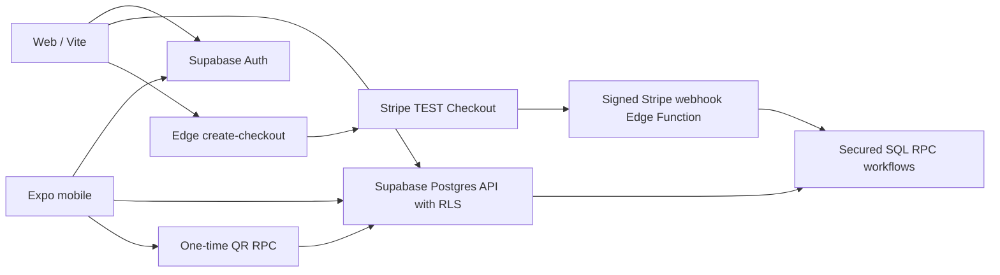

# Architecture — Phase 04 implementation baseline

## Security and data ownership

- `auth.users` manages identities; `profiles` and `user_roles` represent app users and actual roles.
- `clubs` owns its lecturer, five named committee positions, and membership applications. Historic organizer assignments remain in a manual migration queue.
- `proposals` owns the current review status and version number. `proposal_versions` holds the immutable review snapshots.
- `committee_position_permissions` grants protected operations per club and named position. The current institution decision enables all catalogued permissions on new clubs; Admin can revoke each grant independently.
- `proposal_authority_assignments` snapshots the current Admin-configured recipients per submitted version. Event/category/budget rule-based routing is still pending; missing recipients sets `routing_exception`, not approval.
- `proposals.published_version` separates public content from the version under review. Students continue to see the last published snapshot while a new version is being reviewed.
- New accounts and email changes are limited in PostgreSQL to Admin-configured university email domains; the initial domain is `edu.lnbti.lk`.
- Notifications are durable, recipient-scoped rows created by database events. Proposal documents use a private Storage bucket with proposal/version access checks and a 10 MB limit.
- PostgreSQL functions serialize review transitions by locking the proposal row (`FOR UPDATE`). The database, not the web UI, enforces configured permissions, version-specific decisions, routing and unanimous clearance.
- `memberships`, `registrations`, and `payment_orders` are server-controlled; a fake frontend payment success cannot activate membership or event access.
- `attendance_tokens` stores only SHA-256 hashes of random one-time tokens. Check-in is server verified and writes attendance plus a pending badge candidate; a committee member with `badge.authorize` must record an explicit reasoned decision before an award is issued.

## Architectural decisions needing institutional confirmation

- Auth is email/password; campus SSO remains future work. Email-domain enforcement is enabled for `edu.lnbti.lk` and Admin can update the allow-list.
- Every proposal passes through its club's assigned Lecturer Coordinator. The current authority recipient configuration is global; role/category/budget-matched routing rules still require implementation and Admin configuration.
- Committee permissions currently start enabled for every catalogued action at each club position, per the user's explicit decision. This differs from the SRS least-privilege default and must be institutionally reviewed before production use.
- Numbered legacy positions are mapped to the five SRS labels by seat number. Existing independent organizer assignments require manual migration into a vacant committee position; conflicts remain queued.
- Club membership applications may be approved by any authorized committee seat.
- Paid checkout is disabled until a provider is selected and configured. Existing fee/payment storage retains its legacy USD-test representation and must be converted to LKR before real checkout.
- Student and committee mobile flows are supplied using Expo; administrative web flows remain web-only. Device registration and transfer approval are explicitly excluded from this delivery; current QR tokens remain single-use and time-limited, but are not device-bound.
